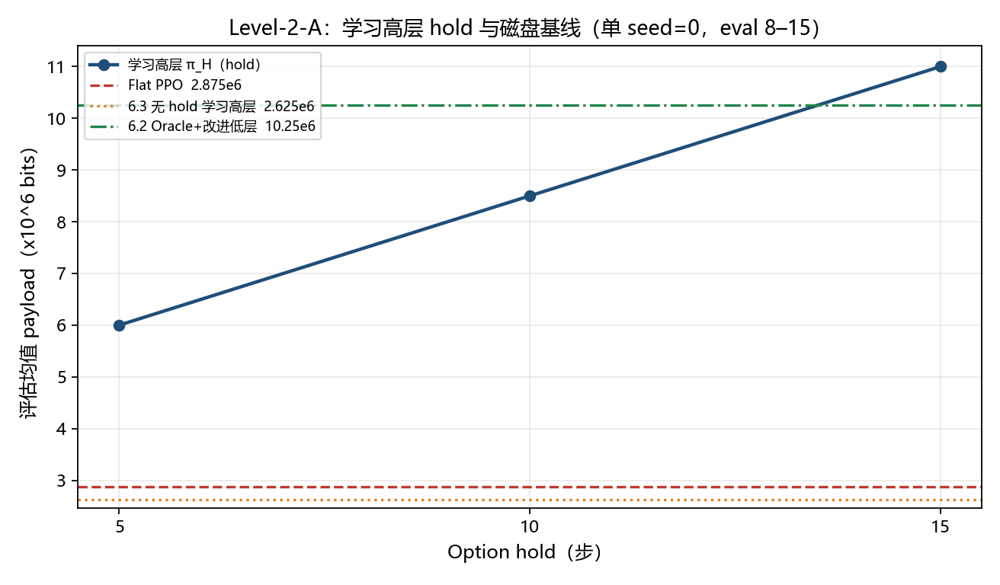
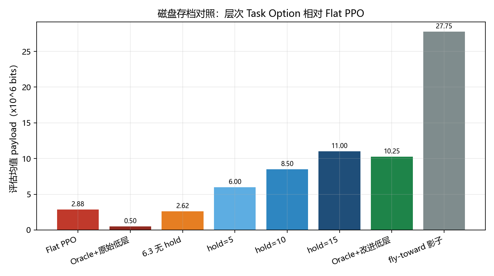
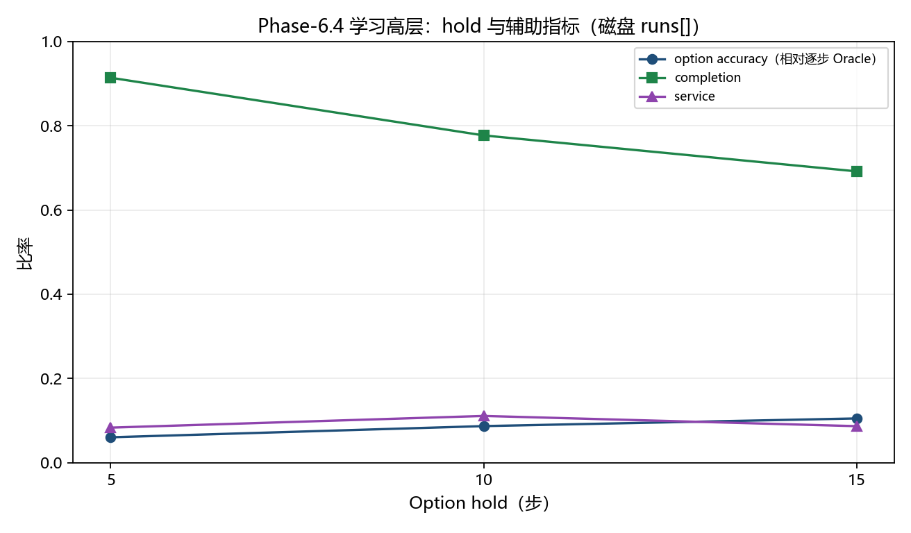
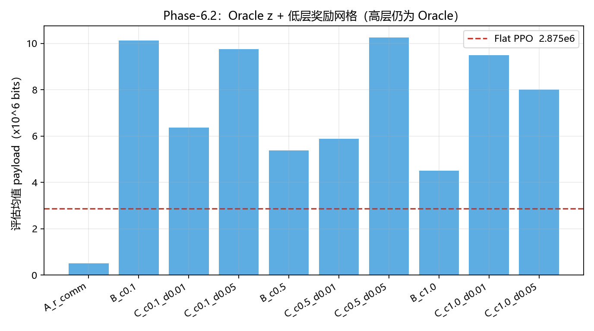

# 层次 Task Option 相对扁平 State-only PPO：历史证据核查

**范围。** 恢复并核查这条历史主张：Hierarchical Task-Waypoint / Task Option 相对扁平 State-only PPO 已有明显收益。权威来源是**磁盘上的历史文件**。未训练、未重跑环境、未改模型、未新建 Round、未覆盖历史报告/JSON、未重算磁盘里已有指标。

**本文新算的量。** 相对提升 `Gain_hold*` 和 payload 比值是按核查要求、对**已存储均值**做的算术，原 JSON 里没有这些键。下文所有 payload / completion / service 数字均从磁盘抄录。

**口头记忆核对。** 记忆量级（Flat PPO ≈ 2.875e6，Oracle+原始低层 ≈ 0.5e6，最佳低层 ≈ 1.025e7，fly-toward 影子 ≈ 2.775e7，hold5/10/15 ≈ 6.0e6 / 8.5e6 / 1.10e7）与磁盘**完全一致**。口头总结与正式文件**没有差异**。

**这条证据不是什么。** 不是把旧 Task-Waypoint `(service, progress, return)` 拼进 PPO，也不是新的空间 Task-Waypoint `(goal, waypoint, horizon)`。Phase-6.2、6.3 JSON 中 `uses_task_waypoint: false`。对比对象是**层次 Task Option**：目标浮标 / idle 分配 `z`、可选的宏 hold、由 hold 长度终止。报告原文也写“未用 Transformer / Task-Waypoint”。

---

## 直观图（仅绘制磁盘均值，未重跑）

图由 `docs/plot_htw_taskoption_vs_flatppo.py` 读取 6.2/6.4 的 `summary.json` 生成。没有误差棒：原文件没有分 seed 标准差。影子 fly-toward **不是**全局最优。

**图 1. 学习高层 hold 折线。** hold=5/10/15 的 payload 随 hold 上升，并穿过 Flat PPO（红虚线）和 6.3 无 hold 学习高层（橙点线）。绿点划线是 6.2 的 Oracle+改进低层，不是学习高层。

**图 2. 方法对照柱状图。** 左起 Flat 与失败的 Oracle+原始低层，中段为学习策略，右侧为 Oracle+改进低层与影子上界。

**图 3. hold 辅助指标折线。** payload 升高时，相对逐步 Oracle 的 option accuracy 仍低（hold=15 约 0.105）；completion / service 不是单调更好。

**图 4. Phase-6.2 低层奖励网格。** 高层固定为 Oracle。仅 `r_comm` 的 A 低于 Flat；带 completion / 距离辅助的变体才能执行 option。

---

## 0. 文件清单（Phase-6.2 / 6.4 与 Flat PPO 链条）

| 类型 | 路径 | 状态 |
|---|---|---|
| 6.1 报告 | `HTW_Phase6_1_oracle_option_controller_report.md` 与 `src/wt/htw_phase61/HTW_Phase6_1_oracle_option_controller_report.md` | 存在 |
| 6.1 JSON | `src/wt/htw_phase61/outputs/oracle_option_ppo/summary.json` | 存在（Flat PPO 主存档） |
| 6.2 报告 | `HTW_Phase6_2_low_level_option_execution_report.md` 与 `src/wt/htw_phase62/HTW_Phase6_2_low_level_option_execution_report.md` | 存在 |
| 6.2 JSON | `src/wt/htw_phase62/outputs/goal_execution/summary.json` | 存在 |
| 6.2 配置/协议 | `src/wt/htw_phase62/run_phase62.py`、`rewards.py`、`vector.py`；环境 `src/wt/l2a/env.py`、`src/wt/l2a/config.py`；Flat/option 网络 `src/wt/htw_phase61/models.py`、`features.py` | 存在 |
| 6.2 测试 | `tests/test_htw_phase62_goal_execution.py` | 存在（单元测试，不是全网格训练日志） |
| 6.3 报告 | `HTW_Phase6_3_learned_option_report.md` | 存在（无 hold 的学习 π_H；Flat PPO 再存档） |
| 6.3 JSON | `src/wt/htw_phase63/outputs/learned_option/summary.json` | 存在 |
| 6.4 报告 | `HTW_Phase6_4_high_level_improvement_report.md` 与 `src/wt/htw_phase64/HTW_Phase6_4_high_level_improvement_report.md` | 存在 |
| 6.4 JSON | `src/wt/htw_phase64/outputs/high_level_improvement/summary.json` | 存在 |
| 6.4 协议 | `src/wt/htw_phase64/run_phase64.py`、`vector.py`、`features.py`、`models.py` | 存在 |
| 6.4 测试 | `tests/test_htw_phase64_high_level.py` | 存在 |
| CSV | `htw_phase61/62/63/64/outputs` 下 | **不存在** |
| 训练/评估日志文件 | 同上 | **不存在**（仅 JSON 内 `last_update`） |
| 独立 gate 文件 | 无单独 `*gate*.json` | 门控是 JSON 布尔键（`beats_state_only`、`enter_high_level` 等） |
| Checkpoint | `src/wt/htw_phase63/outputs/checkpoints/low_level_c05_d005.pt`（6.3/6.4 引用） | **磁盘上不存在** |
| Checkpoint 元数据 | 应在该 `.pt` 内 | **不存在** |
| 6.2/6.4 的 Manifest / README / AGENTS.md | 除 HTW markdown 报告外没有 | 报告 + `run_phase6*.py` 中的常量 |
| 本核查图 | `docs/figures/fig1_hold_payload_line.png` 等 | 由磁盘 JSON 绘制，非新实验结果 |

---

## 1. Phase-6.2 证据链

### 1.1 环境

**Level-2-A。** 类 `L2AEnv`（`src/wt/l2a/env.py`）。配置 `L2AConfig`：`num_uavs=5`，`num_buoys=12`，`episode_horizon=48`，`service_slots=3`（D=3），`service_radius_m=16`，`block_payload_bits=1.0e6`。报告写明：“在 Level-2-A 上只训练低层”。

### 1.2 扁平 State-only PPO 的定义

依据 Phase-6.1 报告第 1 节与 `run_phase61.py` / `L2AStateActorCritic`：

- **输入：** 仅 Level-2-A 的 `state` 特征。UAV 特征维 `UAV_DIM=8`（`htw_phase61/features.py`）。JSON：`state_only.uav_dim = 8`。
- **没有高层 option：** 关联由脚本 **`myopic_assignment`** 写入，不是 Oracle `z`，也不是学习的 π_H。族键 `"family": "state_only"`。
- **动作：** Round-30 PPO（`PPOAgent`）输出连续 UAV **运动** `(5,2)`。匹配由脚本写入 `env.step(movement, association)`；策略不输出关联。

评估：种子 `[8,…,15]`（6.1 JSON 的 `eval_seeds`），**8 个 episode** 的 payload 均值。训练：种子 `[0,…,7]`，**训练随机种子只有 `SEED=0`**，80 updates，rollout=48，num_envs=4。

### 1.3 扁平 State-only PPO 的 payload（磁盘）

| 来源 | 键 / 位置 | 值 |
|---|---|---|
| 6.1 JSON | `state_only.mean_payload_bits` | **2875000.0** |
| 6.2 JSON | `state_only.mean_payload_bits` | **2875000.0** |
| 6.2 报告表 `state_only` 行 | payload | **2875000** |

同条记录还有：`mean_return=2.875`，`goal_completion_rate=0.1078125`（报告写成 0.108），`service_success_rate=0.01197916666666667`（报告写成 0.012），`mean_movement_m=778.9786409993876`（报告写成 779.0），`mean_residual_queue_blocks=39.125`，`mean_dropped_blocks=78.0`，`mean_time_to_in_range=8.1`，`mean_time_to_service=35.75`。

6.2 在相同种子与预算下**重新训练**了 Flat PPO（`run_phase62.py` 的 `train_state_only`）；存下来的均值与 6.1 相同。

### 1.4 Oracle Option + 原始低层 PPO（仅稀疏 `r_comm`）

这是 Phase-**6.1** 以及 Phase-6.2 变体 **`A_r_comm`**（`lambda_c=0`，`lambda_d=0`），**不是**学习得到的高层策略。

- 6.1 JSON `oracle_option.mean_payload_bits` = **500000.0**
- 6.2 JSON `option_runs[0]`，`variant` 为 `A_r_comm` = **500000.0**
- 报告：“A 仅 `r_comm` 仍约 5e5，复现 6.1 失败。”

### 1.5 低层辅助奖励（6.2 网格）

控制器内部奖励（`htw_phase62/rewards.py`）；**环境** `r_comm` 未改。评估 return 仍是环境块数和。

- **A：** `r_low = r_comm`（`λ_c=0`，`λ_d=0`）
- **B：** `r_low = r_comm + λ_c · 1[进入 z 的服务半径]`（`λ_d=0`）；磁盘名 `B_c0.1`、`B_c0.5`、`B_c1.0`
- **C：** `r_low = r_comm + λ_c · completion − λ_d · mean_uav(||p−b_z|| / vΔt)`，`λ_c ∈ {0.1,0.5,1.0}`，`λ_d ∈ {0.01,0.05}`；磁盘名 `C_c{λ_c}_d{λ_d}`

JSON 键：`lambda_c`、`lambda_d`、`variant`。

| 变体 | λ_c | λ_d | `mean_payload_bits` | `goal_completion_rate` | `service_success_rate` | `mean_movement_m` |
|---|---:|---:|---:|---:|---:|---:|
| A_r_comm | 0 | 0 | 500000.0 | 0.10989583333333333 | 0.0020833333333333333 | 1348.064285981005 |
| B_c0.1 | 0.1 | 0 | 10125000.0 | 0.31614583333333335 | 0.0421875 | 732.4868845749033 |
| C_c0.1_d0.01 | 0.1 | 0.01 | 6375000.0 | 0.10052083333333334 | 0.026562500000000003 | 1037.5590326442252 |
| C_c0.1_d0.05 | 0.1 | 0.05 | 9750000.0 | 0.22291666666666665 | 0.040625 | 1363.6311564379373 |
| B_c0.5 | 0.5 | 0 | 5375000.0 | 0.7749999999999999 | 0.022395833333333334 | 1614.9354190293427 |
| C_c0.5_d0.01 | 0.5 | 0.01 | 5875000.0 | 0.7015624999999999 | 0.024479166666666666 | 1883.7314776519158 |
| **C_c0.5_d0.05（最佳）** | **0.5** | **0.05** | **10250000.0** | **0.5859375** | **0.04270833333333334** | **2677.313148844226** |
| B_c1.0 | 1.0 | 0 | 4500000.0 | 0.6171875 | 0.018750000000000003 | 2861.8014024115614 |
| C_c1.0_d0.01 | 1.0 | 0.01 | 9500000.0 | 0.6864583333333334 | 0.03958333333333333 | 2321.288781994403 |
| C_c1.0_d0.05 | 1.0 | 0.05 | 8000000.0 | 0.7484375 | 0.03333333333333333 | 3036.2876237359837 |

JSON `best_option.variant` = `C_c0.5_d0.05`。另有 `mean_return=10.25`，`mean_time_to_in_range=5.625`，`mean_time_to_service=33.675`，`mean_residual_queue_blocks=37.25`。

**Idle 率：** 未存储。**分 seed 标准差 / 置信区间：** 未存储（仅 `episodes: 8` 的均值）。

### 1.6 Oracle fly-toward / 影子上界

不是全局最优。磁盘名：`oracle_shadow`（脚本 `oracle_option_assignment` + fly-toward `rollout`）。

- 6.1/6.2 JSON `oracle_shadow.mean_payload_bits` = **27750000.0**
- 另有 `mean_residual_queue_blocks=26.625`，`mean_dropped_blocks=65.625`
- 脚本 myopic + fly-toward：`myopic_scripted.mean_payload_bits` = **13000000.0**

### 1.7 Phase-6.2 证明了什么、没有证明什么

**证明了：** 若高层提供 **Oracle** 任务 option `z`，且低层使用 **目标条件执行奖励**，层次**接口**就能用上扁平 State-only PPO 没用到的性能（`beats_state_only: true`；6.2 报告 payload 差 10250000 − 2875000 = 7375000 bits）。仅稀疏 `r_comm`（`A_r_comm=5e5`）**执行不了**同一套 Oracle `z`。

**没有证明：** **学习得到的**高层 Task-Waypoint / option 策略已经优于 PPO。JSON `trained_high_level: false`。高层仍是 Oracle。

---

## 2. Phase-6.4 证据链

### 2.1 高层是否已学习？低层是否冻结？环境？

- **高层已学习：** `train_high` 训练 `DiscretePPOAgent` / `HighLevelOptionModel`（DeepSets，对 buoy+idle 做分类，再排他投影）。报告：“只优化 π_H(z|s)”。
- **低层冻结：** `modified_low_level: false`；`load_frozen_low()` 来自 Phase-6.2 最佳（`λ_c=0.5`，`λ_d=0.05`）。引用的 checkpoint 路径在**磁盘上缺失**。
- **环境仍是 Level-2-A：** `run_phase64.py` 中的 `L2AEnv()`；报告“不改环境”。
- **仍不是 Task-Waypoint / HGNN：** 6.4 JSON `uses_hgnn: false`；报告“不用 Task-Waypoint”。

### 2.2 比较了哪些宏 hold

代码 `HOLDS = (5, 10, 15)`，此外还有：

- Phase-6.3 的 learned / Oracle+低层：报告表记为 **每步重选**（`hold=1`）
- 奖励塑形 B/C 变体：**仅 hold=5**
- 磁盘上没有其他 horizon

### 2.3 各 hold 的 payload 与辅助指标（磁盘 `runs[]`）

| 名称 | hold | reward_mode | enhanced | `mean_payload_bits` | `goal_completion_rate` | `service_success_rate` | `option_selection_accuracy` | `environment_steps` |
|---|---:|---|---|---:|---:|---:|---:|---:|
| A_hold5 | 5 | delta | false | **6000000.0** | 0.9140625 | 0.08333333333333333 | 0.060416666666666674 | 24576 |
| A_hold10 | 10 | delta | false | **8500000.0** | 0.7770833333333333 | 0.1111111111111111 | 0.08697916666666666 | 49152 |
| A_hold15 | 15 | delta | false | **11000000.0** | 0.6916666666666668 | 0.08680555555555554 | 0.10520833333333333 | 61440 |
| B_episode | 5 | episode | false | 3250000.0 | 0.9057291666666667 | 0.06380208333333334 | 0.0203125 | 24576 |
| B_delta_service | 5 | delta_service | false | 5000000.0 | 0.7958333333333334 | 0.06510416666666666 | 0.07760416666666667 | 24576 |
| B_delta_service_delay | 5 | delta_service_delay | false | 5250000.0 | 0.7916666666666665 | 0.08203125 | 0.04895833333333334 | 24576 |
| C_enhanced_delay | 5 | delta_service_delay | true | 6000000.0 | 0.8541666666666666 | 0.09375 | 0.058854166666666666 | 24576 |

JSON `best.name` = `A_hold15`。**Idle：** 未存储。**队列下降：** 6.4 的 run 行未存（仅 6.2 的 Flat / 最佳低层有 `mean_residual_queue_blocks`）。

### 2.4 6.4 文件里的 Flat PPO 基线

JSON `state_only.mean_payload_bits` = **2875000.0**（completion / service / accuracy 与 6.1–6.3 相同）。

**来源：** `run_phase64.py` 读取 `prior = json.loads(PHASE63_JSON)`，再设 `state = prior["state_only"]`。Phase-6.4 **没有重新评估** Flat PPO。Phase-6.3 **重新训练**了 Flat PPO（`train_state_only()`），`SEED=0`、评估种子、`L2AEnv`、80 updates / rollout=48 与 6.1/6.2 相同。

**同一任务 / 环境 / 评估种子：** 是（Level-2-A，eval 8–15）。**与带 hold 的学习策略训练协议完全相同：** 否（见第 5 节）。

6.4 JSON 中 Oracle + 冻结低层：`oracle_option.mean_payload_bits=10250000.0`（与 6.2 最佳一致）。Phase-6.3 无 hold 的 learned：`2625000.0`（**低于** Flat PPO）。

---

## 3. 相对提升（对已存储均值做算术）

令 `P_flat = 2875000.0`。

| 对比 | 公式 | 值 |
|---|---|---|
| Gain_hold5 | (6000000 − 2875000) / 2875000 | **1.086956…（约 108.7%）** |
| Gain_hold10 | (8500000 − 2875000) / 2875000 | **1.956521…（约 195.7%）** |
| Gain_hold15 | (11000000 − 2875000) / 2875000 | **2.826086…（约 282.6%）** |
| hold15 / Flat 比值 | 11000000 / 2875000 | **3.826086…（约 3.83×）** |
| 6.2 最佳低层 / Flat | (10250000 − 2875000) / 2875000 | **2.565217…（约 256.5%）** |
| 6.2 最佳 / 影子 | 10250000 / 27750000 | **0.369369…（约 37%）** |
| 6.1 Oracle+原始低层 / Flat | (500000 − 2875000) / 2875000 | **−0.826086…（更差）** |

这些比值**不是**置信区间。

---

## 4. 统计地位

**这是显著的历史实验优势，但还不是最终多 seed 统计显著性证明。不要写成 statistically significant。**

磁盘上可见：

- **一个训练 seed：** 6.1/6.2/6.4 JSON 均为 `"seed": 0`
- 评估是场景种子 8–15 上的**均值**（`episodes: 8`）；JSON 中**没有**分 seed 的 payload 向量、**没有**标准差、**没有** 95% CI、**没有** bootstrap、**没有**配对场景检验
- `last_update.advantage_std` 是 PPO 训练诊断，不是 payload 不确定度

---

## 5. 是否同一套协议（apples-to-apples）

| 项目 | 扁平 State-only PPO | 层次 Task Option（6.2 / 6.4） | 是否一致 |
|---|---|---|---|
| 环境 | Level-2-A | Level-2-A | 是 |
| 评估场景 | 种子 8–15 | 种子 8–15 | 是 |
| 训练场景 | 种子 0–7 | 种子 0–7 | 是 |
| 进程种子 | 0 | 0 | 是 |
| Episode 长度 | 48 | 48 | 是 |
| **报告** payload 对应的环境量 | cumulative payload bits | 相同 | 是 |
| PPO **优化器**族 | Round-30 PPO | 低层相同；6.4 π_H 为离散 PPO，`rollout_length=16`，低层/Flat 为 `48` | **部分** |
| 关联 | myopic 脚本 | Oracle（6.2）或学习 π_H（6.4） | **有意不同** |
| 策略输入 | state，`uav_dim=8` | `[state,z]`，`uav_dim=21`（6.2）；DeepSets 高层（6.4） | **否** |
| 训练 updates | 80 | 80 | 是（次数） |
| 训练期环境步数 | 6.2/6.3 `environment_steps=15360` | 6.4 hold5=24576，hold10=49152，hold15=**61440** | **否** |
| 6.4 的 Flat 数字 | 从 6.3 JSON 拷贝 | 不是 6.4 新评估 | **拷贝** |
| 冻结低层 checkpoint | 不适用 | 路径有记录，**文件缺失** | 可复现性缺口 |
| Level-3-B / SINR | 否 | 否 | 不适用（不在本链） |

**证据类别：B — 同一实验链、较强可比，但不是严格同一协议。** 类别 A 需要相同的环境步训练预算、在 6.4 内重新评估 Flat PPO，以及不确定度。类别 C 是跨阶段/跨环境套用（例如把 Phase-9 的 L3-B 写进这里）；本核查**没有**这样做。

---

## 6. 最直接的原始证据位置（行 / 键 / 章节）

**Phase-6.2 最关键**

- 报告：`HTW_Phase6_2_low_level_option_execution_report.md` 第 3 节表、第 4 节问题 3
- JSON：`src/wt/htw_phase62/outputs/goal_execution/summary.json`
  - Flat：`state_only.mean_payload_bits`
  - 最佳低层：`best_option.mean_payload_bits` / `best_option.variant`
  - 影子：`oracle_shadow.mean_payload_bits`
  - Oracle+原始 PPO：`option_runs` 中 `variant=="A_r_comm"`

**Phase-6.4 最关键**

- 报告：`HTW_Phase6_4_high_level_improvement_report.md` 第 3 节表
- JSON：`src/wt/htw_phase64/outputs/high_level_improvement/summary.json`
  - Hold：`runs[i].name` ∈ `{A_hold5,A_hold10,A_hold15}`，字段 `mean_payload_bits`
  - 最佳：`best.name`，`best.mean_payload_bits`
  - Flat（拷贝）：`state_only.mean_payload_bits`

**Flat PPO 主文件：** `src/wt/htw_phase61/outputs/oracle_option_ppo/summary.json` → `state_only`

**无 hold 的学习高层：** `src/wt/htw_phase63/outputs/learned_option/summary.json` → `learned_option.mean_payload_bits`（2625000.0）

**Hold 时域结果：** 如上 6.4 的 `runs` 数组。无 CSV。

---

## 7. 历史证据表

| 实验 | 高层 | 低层 | Hold | Payload（bits） | 相对 Flat PPO | 证据性质 |
|---|---|---|---|---:|---:|---|
| 扁平 State-only PPO | 无（myopic 关联） | PPO 运动 | 逐步 / 直接 | 2875000.0 | 基线 | 单 seed=0；8 场景评估均值；6.4 为拷贝 6.3 |
| Phase-6.1/6.2 Oracle Option + 原始低层 | Oracle `z` | 仅 `r_comm` 的 PPO | 每步 Oracle | 500000.0 | −82.6% | 层次接口存在但未执行；非学习 π_H |
| Phase-6.2 Oracle Option + 改进低层 | Oracle `z` | 目标条件 PPO `C_c0.5_d0.05` | 每步 Oracle | 10250000.0 | +256.5% | 证明 option **可执行价值**；高层仍是 Oracle |
| Phase-6.2 Oracle fly-toward 影子 | Oracle `z` | 非学习 fly-toward | 脚本 | 27750000.0 | +865.2% | 影子上界，非全局最优，非学习策略 |
| Phase-6.3 Learned Option | 学习的 DeepSets π_H | 冻结的 6.2 低层 | 每步重选 | 2625000.0 | −8.7% | 学习高层 **未**超过 Flat |
| Phase-6.4 Learned Option | 学习 π_H | 冻结低层 | 5 | 6000000.0 | +108.7% | 单 seed 实验优势 |
| Phase-6.4 Learned Option | 学习 π_H | 冻结低层 | 10 | 8500000.0 | +195.7% | 同上 |
| Phase-6.4 Learned Option | 学习 π_H | 冻结低层 | 15 | 11000000.0 | +282.6%（3.83×） | 本链最佳学习结果；非多 seed CI |

---

## 8. 三个层次的结论

**结论1 — Task Option 是否具有可利用的控制价值？**  
**是（在 Level-2-A 上，相对 Flat PPO）。** Phase-6.2：Oracle `z` + 可执行低层 → 1.025e7 vs Flat 2.875e6；同一 Oracle `z` + 稀疏 `r_comm` 低层只有 5e5。影子 fly-toward 2.775e7 说明剩余执行空间仍大。这**不是**“学习得到的 Task-Waypoint 已经优于 PPO”。

**结论2 — 学习得到的层次策略是否曾经超过 Flat PPO？**  
**是，但仅在本实验链、hold≥5、单个训练 seed。** Phase-6.4 `A_hold15` 1.10e7 > 2.875e6。Phase-6.3 无 hold 的学习 π_H（2.625e6）**没有**超过 Flat。相对逐步 Oracle 的 option accuracy 在 hold=15 仍只有 0.105。

**结论3 — 是否足够支持最终论文：Task-Waypoint 稳定显著优于 Flat PPO？**  
**否。尚未完成最终正式统计验证。** 该主张还缺：同一 **Level-3-B** 环境；**5–8 个 model seed**；配对场景与 **95% CI**；空间 Task-Waypoint `(G,W,H)` 而非浮标 option `z`；冻结低层的 checkpoint；payload 标准差。L3-B 上的 GRAPH-A / PPO 微调是后续独立锁定，**不在本次核查范围**。

---

## 9. 版本区分（不要混用）

| 名称 | 是否出现在 6.2/6.4 磁盘结果中 |
|---|---|
| 旧 TW `(service, progress, return)` 进入 actor | 否（`uses_task_waypoint: false`） |
| 新空间 TW `(goal, waypoint, horizon)` | 否 |
| 层次 Task Option `(浮标/idle z, hold, 终止)` | **是 — 本次核查对象** |
