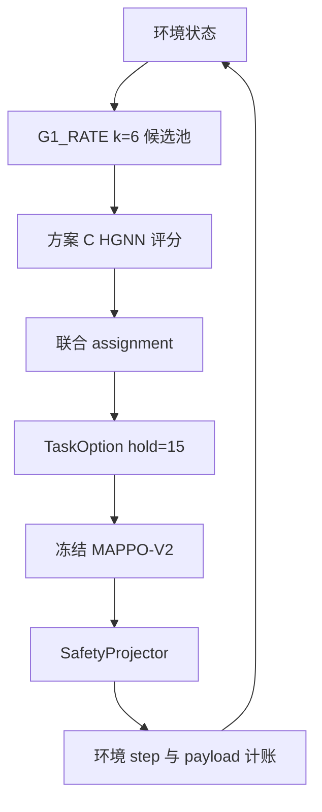

# 多无人机高低层轨迹规划系统总报告

本文件是当前研究系统的权威说明。数字来自已保存的 `summary.json` 和代码中的配置，不把尚未重新运行的结论写成新实验结果。仓库根目录仍保留被 `src` 引用的阶段报告；没有代码引用的过程报告已按全文合并到 `docs/archive/merged/`。盘点见 `docs/archive/REPOSITORY_CLEANUP_INVENTORY.md`，删除记录见 `docs/archive/DELETION_AND_MERGE_LOG.md`。

## 1. 项目目标与研究问题

研究目标是一个由高层任务规划器和低层轨迹控制器组成的多无人机闭环系统。高层在每个决策时刻从合法的无人机—浮标分配中选择一组目标，低层在随后的若干步内控制无人机运动，环境按真实服务规则累计交付 payload。要研究的是高层目标选择与低层实际执行是否一致，以及这种组合相对固定的速率基线能否提高完整 episode 的交付量。

环境规模由 `L3BConfig` 决定：6 架无人机、12 个浮标、horizon 48、服务半径 16 m、单步长度 22 m、option hold 15。配置索引为 `configs/environment/l3b.json`。

## 2. 系统总体架构

正式入口是 `src/wt/benchmark_v2/phase6f_system_bringup/episode.py` 的 `run_active_episode`。它读取 `results/phase6iaa_formal_planner/active_policy.json`，构造 `FormalPlanner`，再调用 `run_closed_episode`。历史函数 `run_episode` 仍走 k=5，不是当前正式链路。



一次决策的数据关系如下。

| 模块 | 输入 | 输出 | 状态更新 |
| --- | --- | --- | --- |
| 候选生成 | 当前环境快照 | 13327 个合法 assignment | 不改环境 |
| HGNN + matching decoder | UAV、浮标、UAV–浮标边、UAV–UAV 边、全局特征 | 每个候选一个分数 | 不改环境 |
| 排序 | 分数 | 稳定排序后的第一名 | 非法或非有限分数则停止 |
| TaskOption | 选中的 assignment | 关联向量，hold 15 | 失败则不保留未经验证的目标 |
| MAPPO-V2 | 观测与 TaskOption | 相对 fly-toward 的二维残差 | 只改运动意图 |
| SafetyProjector | 残差动作 | 投影后的一步 | 约束失败或非有限投影时该步为零并记干预 |
| 环境 | 投影动作 | 服务 bit、队列、SINR、干扰 | `payload_bits` 增加 `served_bits` 之和 |

决策时刻是 0、15、30、45。hold 期间不重新评分。

## 3. 高层规划模型

实现在 `src/wt/lowlevel_v2/phase5l_joint_encoder/model.py` 与 `src/wt/lowlevel_v2/phase5k_joint_decoder/decoders.py`。节点和边的宽度来自 `src/wt/htw_phase9/const.py`。

- UAV 节点宽度 8，浮标节点宽度 7。浮标队列通道在构图时追加到边特征，原始 UAV–浮标边宽 3，追加后为 4。
- UAV–UAV 边宽 2。两层 UAV–浮标消息传递，一层 UAV–UAV 消息传递，自身不连边。
- 全局特征宽度 3。`condition` 把编码器输出与全局特征混合，读出层权重初始为 0。
- 推理图由 `graph_from_env` 从当前环境生成。`j15_bits`、`utility_rank`、`future_sinr`、`mappo_value`、`served_bits` 不是模型输入。
- 图形状为 UAV `[1,6,8]`、浮标 `[1,12,8]`、UAV–UAV `[1,6,6,2]`、全局 `[1,3]`、assignment `[13327,6]`。空闲目标记为 `-1`。

候选池由 Phase-6E 的 `G1_RATE` 生成。瞬时假设速率除以全矩阵最大值后取每架无人机的前 6 个浮标；相等速率用稳定排序保留较小浮标编号。Phase-6D 枚举合法组合：空闲在前，随后是该无人机的 top-k 浮标；空闲不占浮标，重复的非负浮标非法。正式规划器使用 k=6。Phase-6F 历史入口的 `CANDIDATE_K` 仍是 5，不能改成 6。

方案 C 与 Epoch 6 共用同一个 matching decoder。decoder 对选中的无人机—浮标对打分并求和，空闲项不加分。正式排序必须调用 `decoder.score_assignments`。Top-1 使用 `np.argsort(-scores, kind="stable")`。

方案 C 的权重是 `results/phase6if_ranking_loss/runs/c/epoch_001.pt`，SHA-256 为 `f77c0bcef3f359e01de35b75753f3776a9e8332bf65fd191f112236df074f864`。它从 Epoch 6 checkpoint `results/phase6id_joint_utility_training/epoch_006.pt`（SHA-256 `7859f9c94940d9259ab1bece1f8dddf9655a4dcb1cd45d537ad127347526bcde`）出发，只继续训练编码器。损失是 `top_regret_loss`：把 J15 bit 标签线性归一化后做 `LISTNET_BETA=30` 的 softmax 目标，再对分数做 log-softmax 交叉熵。标签不是模型输入。

训练与验证划分在 `src/wt/benchmark_v2/phase6ib_highlevel_dataset/protocol.py`：训练场景 322000–322047，验证场景 322048–322063，标签名 `J15_MAPPO_CURRENT`，标签由冻结的 MAPPO-V2 在 15 步窗口上产生。`utility_rank` 只用于审计，1 bit 以内视为并列。

离线验证上，方案 C Epoch 1 相对 Epoch 6 的短程记录是：平均 J15 由 18,892,120 bit 到 19,240,091 bit，Top-1 由 0.5625 到 0.6667，Top-3 由 0.6250 到 0.7083，Top-5 由 0.6667 到 0.7083，归一化 regret 由 0.0507 到 0.0355。中位配对差为 0，48 个状态中 14 个上升、7 个下降。方案 C 的后续 epoch、方案 A 的 gap 加权损失、方案 B 的容差间隔损失，以及后来的交互头和融合头，都没有成为正式规划器。这些离线排序指标不是完整 episode 的交付量。

当前正式文件 `active_policy.json` 的内容是 `generator=G1_RATE`、`high_level_policy=scheme_c`、`k=6`、`hold=15`、`historical_formal_k=5`。文件缺失或字段非法会抛出 `PolicyError`，不会静默回退到方案 C。

## 4. 低层轨迹控制模型

低层是 Residual MAPPO-V2，实现在 `src/wt/lowlevel_v2/residual_policy.py`。Actor 先编码邻居，输出宽度 16；自身、任务、通信、邻居和一项附加特征进入隐藏宽度 64 的网络，均值维度为 2，`log_std` 初值为 -1，均值头零初始化。集中式 Critic 隐藏宽度 128。推理使用 `tanh(mu)` 的确定性均值，不从正态分布采样。观测宽度来自 `observation.py`：自身 5、任务 8、通信 4。

动作是相对 fly-toward 的二维残差，再经过 SafetyProjector。约束失败或投影非有限时，该步记零并计一次干预；投影范数大于 `1e-3` 也计干预。MAPPO 不选择 assignment，只执行已经给定的 TaskOption。

Phase-6G 的低层奖励是 `served_bits / block_payload_bits`，再减去投影惩罚和残差惩罚。`block_payload_bits` 为 1,000,000。完整 episode 的研究指标是环境累计的 `payload_bits`，不是这个训练奖励本身。

保留的 checkpoint 是 `src/wt/benchmark_v2/phase6g_lowlevel_mappo/checkpoints/phase6g_seed0.pt`，SHA-256 为 `92aa68785c898415439ad8c6480427593e10c851e3d392ee3a8110f3a58dbd0e`。Actor 由旧的 `mappo_original.pt` 热启动，Critic 重新初始化。正式闭环使用 seed 0。同一状态和同一 TaskOption 下，MAPPO-V2 相对 fly-toward 的场景等权配对差为 621,455.224 bit，95% 置信区间为 [502,582.599, 752,570.564] bit，按 1 bit 阈值全部场景为正。该对照使用了五个种子，记录在 `HTW_Phase6G_BenchmarkV2_LowLevelMAPPO_CN.md`。

低层尚未单独证明它在运动约束、干扰和服务进度同时变化时做了超出“朝目标残差加投影”的轨迹规划。干扰和服务进入环境转移，但 Actor 的动作只通过观测间接看到这些量。

## 5. 高低层协同机制

高层每 15 步决策一次。`make_option` 把选中的 assignment 写成 TaskOption，关联向量包含 `-1` 空闲，hold 为 15。低层在这 15 步内用同一个 TaskOption 产生动作。每步环境结算服务并累加 payload，下一步的图从更新后的状态重建。

两个模型分开训练。高层标签是冻结 MAPPO-V2 上的 15 步 J15 bit；低层奖励是单步服务比例减惩罚。组合运行时两边的权重都冻结。这是冻结模块的闭环执行，不是高低层联合微调，也不是端到端联合训练。

因此可能出现三类脱节：离线 J15 标签与完整 48 步交付量不是同一个量；hold 期间环境变化但目标不更新；低层只优化自己的单步奖励，不直接优化高层排序损失。

## 6. Benchmark 与对照实验

统计单位是场景。一个 episode 内的时间步不是独立样本。置信区间是 10,000 次 bootstrap、种子 0、2.5 与 97.5 分位。1 bit 以内记为持平。

### 6.1 指标类型

| 类型 | 代表结果 | 不能解读成 |
| --- | --- | --- |
| 离线排序 | 方案 C Epoch 1 的 J15、Top-k、regret | 完整 episode 交付量 |
| 短窗口闭环 | Phase-6I-Z，验证场景 t=15 后 15 步 | 从 reset 开始的 48 步 |
| 完整 episode 验证 | Phase-6I-AB，322048–322063 | 独立泛化 |
| 独立保留测试 | Phase-6I-AC，322064–322079 | 所有场景都优于基线 |

### 6.2 完整 episode

验证集 16 个场景，`results/phase6iab_planner_stability/summary.json`：

- 方案 C 平均 payload 68,917,978.772 bit，中位数 69,133,068.914 bit。
- G1_RATE k=6 平均 payload 66,272,987.963 bit，中位数 64,541,396.380 bit。
- 平均配对收益 2,644,990.809 bit，中位数 2,078,599.157 bit。
- 95% 置信区间 [180,100.077, 5,016,616.161] bit，下界大于 0。
- 11 个场景为正，0 个持平，5 个为负。
- 平均完成 block 66.0625 对 63.3125。
- 平均剩余队列 4,943,983.129 bit 对 5,467,111.934 bit。
- 平均 episode 时间 1.929 s 对 2.178 s。

独立保留测试 16 个场景，`results/phase6iac_independent_holdout/summary.json`：

- 方案 C 平均 payload 69,150,547.900 bit，中位数 69,307,228.649 bit。
- G1_RATE k=6 平均 payload 65,648,356.373 bit，中位数 64,012,311.170 bit。
- 平均配对收益 3,502,191.527 bit，中位数 3,829,743.936 bit。
- 95% 置信区间 [1,270,476.687, 5,395,098.501] bit，下界大于 0。
- 14 个场景为正，0 个持平，2 个为负：322065 为 -8,162,003.816 bit，322071 为 -1,870,922.332 bit。
- 最大正收益是 322070 的 +10,184,359.922 bit。
- 平均完成 block 66.3125 对 62.5625。
- 平均剩余队列 5,299,417.401 bit 对 5,480,873.712 bit。
- 平均 SINR 0.376 对 0.228，平均干扰 0.0662 对 0.0658。
- 平均服务步数 34.68 对 36.91，平均目标切换 16.06 对 15.50。
- 平均 episode 时间 1.538 s 对 1.764 s。

两次对照都使用冻结 MAPPO-V2 与 G1_RATE k=6。验证集参与过模型选择；保留测试没有参与选择，但正向区间只说明这 16 个已测场景的平均配对收益为正。

Phase-6I-Z 的 15 步窗口平均配对差是 +334,120.24 bit，置信区间跨过 0，Gate 保持 `CLOSED_LOOP_GAIN_INCONCLUSIVE`。它不覆盖 AB 和 AC。

## 7. 当前实验结论

- Phase-6I-AB 的验证集平均配对收益是 2,644,990.809 bit，95% 置信区间下界为 180,100.077 bit。
- Phase-6I-AC 的独立保留测试平均配对收益是 3,502,191.527 bit，95% 置信区间下界为 1,270,476.687 bit。
- 两组对照的低层都是冻结 MAPPO-V2，基线都是 G1_RATE k=6。
- 方案 C Epoch 1 已接入 `run_active_episode`。两份 summary 中的 `planner_ready` 均为 1，即 `planner_ready = True`。
- 保留测试支持当前冻结组合在已测场景上的平均泛化表现。它不证明每个场景都优于基线，AC 中仍有两个负收益场景。

## 8. 当前尚未解决的问题

以下问题都有代码或结果依据。

- AB 有 5 个负收益场景，AC 有 2 个。平均为正并不等于逐场景可达。
- 高层按 15 步 J15 标签训练，评估却看 48 步 payload。两个量已经在 6I-Z 与 AB/AC 中表现为不同结论。
- 低层动作是 fly-toward 残差加投影。它控制位置增量，不直接输出 assignment，也不在 hold 内重新规划目标。
- 低层训练奖励包含投影惩罚和残差惩罚，完整指标只计交付 bit。奖励与 payload 的方向一致程度没有在当前闭环里单独量化。
- hold=15 期间队列、干扰和几何关系变化，目标保持不变。AC 中方案 C 的平均目标切换次数高于基线，服务步数却更少，说明切换次数与交付量不是同一个指标。
- 高低层没有联合微调。高层看不到低层在完整 episode 中的后续偏差，低层也看不到高层的排序损失。
- 已测场景是 322000–322079 这一连续编号段中的训练、验证和保留测试。其他地理布局、到达过程和规模没有被这组实验覆盖。
- 现有耗时来自 Windows CPU、单线程 PyTorch 的已保存审计，不是跨平台的计算复杂度结论。

## 9. 后续研究路线

### P0 闭环语义审计

目标是确认现有闭环的接口语义。输入是 `run_active_episode`、TaskOption、SafetyProjector 和环境 `step`。输出是一份接口对照，列出 assignment、hold、服务 bit 和 payload 的来源。评价指标是同一场景重复运行的 payload 差不超过 1 bit，且非法候选、空池和非有限分数会停止。停止条件是对照完成，或发现一处会改变 322002 已记录决策的语义错误。发现错误时停止后续阶段。

### P1 目标可达性与实现收益

目标是把高层选中的目标同低层实际轨迹分开。输入是已保存的完整 episode 轨迹和对应 assignment。输出是每个决策的预计服务与执行后服务之差。评价指标是场景级配对差，不把时间步当独立样本。停止条件是 16 个验证场景的差异表完成。保留测试只作核对，不用于改模型。

### P2 协同改进实验

目标是在固定基线和固定指标下改进组合。基线是 G1_RATE k=6 加冻结 MAPPO-V2，指标是完整 episode payload 的场景级配对收益。输入优先复用方案 C Epoch 1 和 `phase6g_seed0.pt`。输出是验证集上的新对照。停止条件是验证集置信区间下界大于 0 且负场景数不多于 AB，或者一轮改动没有达到该标准。未达到标准时不读取保留测试。

### P3 消融与多种子

目标是检查增益来自哪个模块。输入是 P2 保留下来的候选。消融至少分开高层排序、低层残差和 hold。评价指标仍是验证集场景级 payload。多种子只重复训练或评估被改动的部分。停止条件是验证集结论对种子稳定，或证明增益只在单个种子出现。322064–322079 的现有 AC 结果保持不变，不参与调参。

### P4 论文材料

目标是整理可复现 benchmark、架构图、公式和表格。输入是 P0–P3 的冻结结果。输出是场景划分、checkpoint 哈希、命令和验证/测试表格。停止条件是第三方能按第 10 节从 reset 跑通一个完整 episode，并核对 summary 中的哈希。

## 10. 复现说明

本机清理和近期审计使用的是 `py -3`，版本为 Python 3.14.2。`requirements.txt` 仍是上游 RvS 的旧版本约束，包括 torch 1.13.0 与 numpy 1.21.6；它没有被重新验证为上述 episode 的运行环境。

在仓库根目录执行：

```powershell
$env:PYTHONPATH="src"
py -3 -c "from wt.benchmark_v2.phase6f_system_bringup.episode import run_active_episode; result=run_active_episode(322002); print(result['payload_bits'])"
```

322002 是已经用于集成回归的场景。正式策略文件应保持方案 C、k=6、hold=15。返回的 payload 在 1 bit 容差内应对应 69,252,475.119 bit。

已存在的模块入口还有：

- `py -3 -m wt.benchmark_v2.phase6g_lowlevel_mappo.run_phase6g`
- `py -3 -m wt.benchmark_v2.phase6iab_planner_stability.audit`
- `py -3 -m wt.benchmark_v2.phase6iac_independent_holdout.audit`

后两条会重跑完整对照。AB 会再次使用参与过选择的验证集。AC 会读取保留测试 322064–322079，不能为了调参重复运行。单元测试入口是 `py -3 -m unittest`。

场景划分：训练 322000–322047，验证 322048–322063，保留测试 322064–322079。环境 reset 种子是场景编号；每条臂的 torch 种子是 `1000000 + scenario`。输出目录分别是 `results/phase6iab_planner_stability/` 与 `results/phase6iac_independent_holdout/`。

关键 checkpoint 与哈希见 `docs/archive/REPOSITORY_CLEANUP_INVENTORY.md`，路径索引见 `configs/`。

## 仓库组织

代码包保持 `src/wt`。把它改名为新的包会破坏现有 `wt.*` 导入和报告路径。当前研究入口按配置目录索引：

```text
README.md
LICENSE
requirements.txt
configs/
docs/
├── SYSTEM_OVERVIEW_CN.md
└── archive/phase_reports/
results/
├── root_exports/
└── phase6if_ranking_loss/
src/
tests/
```

过程报告不再放在仓库根目录。`backup/` 和 `round_01`–`round_36` 仍在原处，轮次测试按这些路径读取。checkpoint 在对应的 `results/phase*` 目录中。
