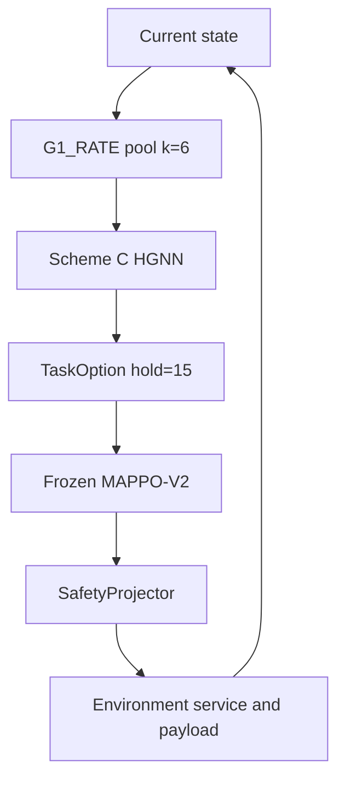

# Execution-Grounded Hierarchical Graph Learning for Multi-UAV Maritime Data Collection

Tiancheng Zheng

*Revised research manuscript | 2 November 2026 | Evidence through E18*

**Abstract.** Multi-UAV maritime data collection couples discrete buoy assignment with continuous motion and finite-queue service. We study a modular hierarchy in which a heterogeneous graph neural network (HGNN) ranks legal assignments using short-horizon execution labels, and a frozen residual multi-agent proximal policy optimization (MAPPO) controller executes each assignment with safety projection. Historical 48-slot benchmarks report mean payload gains of 2.645 Mbit on development validation and 3.502 Mbit on a separate holdout against the same-pool rate baseline. We retain these formal results while extending the analysis to synthetic priority-tagged data. Exact replay of 224 evaluation episodes separates age-weighted utility from actual tagged delivery; subsequent reward, queue-observation, and gradient-clipping interventions do not meet their registered adoption criteria. A frozen-controller assignment diagnosis reveals that candidate-prefix truncation can suppress meaningful alternatives. After matching the participating UAV set, 11 of 96 sampled alternatives improve known tagged delivery without reducing payload beyond a 1-bit tolerance, and five also satisfy the communication and safety screens in two training scenarios. These are local counterfactual opportunities, not gains of a deployable priority-aware policy. A fixed small-tag rule with a tag-masked control is preregistered but has no reported execution result at the evidence cutoff.

<b>Index terms:</b> multi-UAV systems; maritime data collection; heterogeneous graph learning; residual MAPPO; FIFO queues; priority tags; reproducibility.

## I. Introduction

Mobile UAV collectors can connect distributed sensor buoys where fixed infrastructure is sparse. Their assignments determine which queues may be served, while motion changes distances, interference, and the geometry of later choices. A hierarchy separates these decisions: the upper layer chooses a joint assignment, and the lower layer executes it through continuous motion. This separation simplifies interfaces but creates a coordination problem when the upper layer is trained against a short execution window and the final objective is cumulative episode delivery.

Our formal system combines a rate-generated legal candidate pool, an HGNN assignment scorer, and a residual MAPPO executor. The scorer is supervised by the payload produced when each candidate is executed with the frozen lower-level controller. Formal evaluation freezes both modules. The system is therefore a composition of separately trained components rather than an end-to-end jointly optimized agent.

The recent research extension asks a narrower question: can a small preference for explicitly tagged data improve its actual delivery while total payload remains the main objective? Waiting time and priority are different quantities. An increase in age-weighted service does not establish an increase in tagged data delivery. Moreover, if the executor cannot change its assigned buoy, a priority reward may not control which tagged queue is served. We investigate these questions with immutable historical results, exact replay, registered controls, and bounded assignment interventions.

The contributions are: (1) an execution-grounded hierarchical assignment-ranking system with a common frozen executor; (2) scenario-paired historical development and holdout benchmarks; (3) a FIFO bucket-level distinction between age-weighted service and actual priority-tagged delivery, verified by full replay; and (4) an assignment-coverage diagnosis showing how enumeration-prefix sampling can hide local service opportunities. The fourth contribution identifies an experimental-design issue and a bounded opportunity; it does not establish a priority-aware deployment policy.

## II. Related Work

### A. UAV association and motion

Learning-based UAV trajectory design has considered data collection, collision avoidance, connectivity, and interference [1], [2]. Queue-aware maritime graph reinforcement learning additionally studies buffered collection and feasible mixed association decisions in a richer sensing-and-communication setting [5]. Our simulator and objective are narrower: two-dimensional movement, fixed sensor buoys, simplified propagation, and exact delivered payload. We do not compare numerical gains across these different physical models or objectives.

### B. Graph representations and modular control

MAPPO provides a centralized-training framework for cooperative agents [3]. Heterogeneous graph learning represents typed nodes and relations [6], while listwise learning emphasizes relative candidate order [7]. We use these ideas for assignment scoring with a fixed executor; the architecture is not claimed to reproduce the full Heterogeneous Graph Transformer. Waypoint Transformer studies intermediate targets in supervised reinforcement learning [4]. The repository derives from that codebase, but the current formal maritime decision path is the HGNN-MAPPO hierarchy described here, not a Transformer motion policy.

### C. Evidence from diagnostic interventions

A counterfactual candidate rollout answers what could happen from a particular state under a chosen assignment. It does not answer whether a causal online selector would choose that assignment, or whether repeated use would improve a complete episode. We keep these levels of evidence separate throughout the priority-aware extension.

## III. System Model and Formal Hierarchy

### A. Environment and exact payload

The canonical configuration has six UAVs, twelve buoys, a 160 m by 80 m region, a 48-slot horizon, a 15-slot task hold, a maximum displacement of 22 m per slot, and a nominal service radius of 16 m. Bandwidth is 1 MHz, the path-loss exponent is 2.2, and same-cluster/cross-cluster interference factors are 1.0/0.08. These are simulator parameters, not measurements from a maritime deployment. The code obtains entity counts and dimensions from configuration.

$$
p_m(t+1)=\Pi_\Omega\!\left(p_m(t)+L u_m(t)\right),\qquad \|u_m(t)\|_2\le1.
$$

A joint assignment is a legal partial injection from UAVs to buoys; -1 denotes an idle UAV, and no non-idle buoy is assigned twice. Actual service requires an eligible link and nonempty queue. The channel accounts for concurrent links and cluster-dependent interference. Service occurs before new arrivals are admitted.

$$
d_k(t)=\min(q_k(t),c_k(t)),\quad q_k(t+1)=q_k(t)-d_k(t)+a_k^{\rm adm}(t).
$$

$$
P=\sum_{t=0}^{47}\sum_k d_k(t).
$$

Here accepted arrivals already respect finite capacity. Generated, dropped, or queued bits are not delivered payload. Numerical queue snapping is tracked separately and must not be credited as service. The formal primary objective is expected episode payload under association, movement, queue, and safety constraints.

### B. Legal candidates and HGNN ranking

At decision times 0, 15, 30, and 45, the formal generator retains each UAV's top six buoy targets by current hypothetical rate and enumerates legal joint assignments, including idle options. The parameter k is a per-UAV target limit, not the number of joint assignments. The reported canonical pool has 13,327 assignments; this count should not be assumed universal across other geometries or configurations. Stable ordering fixes ties and score-to-assignment binding.

The graph contains UAV and buoy nodes, UAV-buoy and UAV-UAV edges, and global context. Formal tensors include UAV [1,6,8], buoy [1,12,8], pair edges [1,6,12,4], UAV-UAV edges [1,6,6,2], and global [1,3]. The encoder exchanges typed messages and conditions on global context. Future payload labels, future SINR, utility ranks, and subsequent delivered bits are excluded from inference inputs. A matching decoder sums selected pair scores; idle terms contribute zero.

$$
S(a_i)=\sum_m {\bf1}[a_{i,m}\ge0]\, f_{\rm pair}(h_m^U,h_{a_{i,m}}^B).
$$

The selected formal scorer is Scheme C Epoch 1, initialized from the HGNN Epoch 6 checkpoint. Its matching decoder remains frozen while the encoder is updated. Candidate labels are the 15-slot executed payload of frozen MAPPO-V2 from a restored state. The original high-level labeling protocol disables future arrivals, unlike the later priority diagnoses, which preserve the natural arrival/tag stream. This protocol difference is retained explicitly.

$$
q_i={y_i-\min_j y_j\over \max_j y_j-\min_j y_j+\epsilon},\quad p_i={e^{30q_i}\over\sum_j e^{30q_j}},\quad {\cal L}=-\sum_i p_i\log{\operatorname{softmax}(S)_i}.
$$

### C. Residual motion and frozen interfaces

TaskOption binds the selected assignment for up to 15 slots. The lower-level actor observes self, task, communication, and neighboring-UAV features and produces a two-dimensional residual around a fly-toward prior. Deterministic evaluation uses the actor mean, with residual scale 0.25.

$$
\delta_m(t)=0.25\tanh(\mu_m(t)),\qquad u_m^{des}(t)=\operatorname{clip}_{unit}(u_m^{fly}(t)+\delta_m(t)).
$$

SafetyProjector processes the joint motion command. A constraint failure or non-finite projection triggers the registered zero-action fallback and is counted. Projection interventions, constraint failures, and measured safety violations are distinct outputs. The low-level actor cannot rematch targets within a hold.

$$
r_{\rm base}(t)=D(t)/10^6-0.05c_{\rm project}(t)-0.01c_{\rm residual}(t).
$$

D(t) is actual delivered bits. This shaped training reward is not the episode payload metric. Formal inference continues to use phase6g_seed0.pt; none of the subsequent priority-aware variants replaces it.

Figure 1. Formal path: current state, G1_RATE k=6 pool, Scheme C HGNN, TaskOption, frozen MAPPO-V2, SafetyProjector, and exact queue service. The priority diagnoses use a separate historical k=5 sampler and do not replace this path.

## IV. Priority-Aware Accounting and Experimental Design

### A. Synthetic tags and FIFO provenance

A separate ledger attaches a binary synthetic tag z to each admitted bucket. Tags do not represent verified maritime business urgency. The environment still serves FIFO: buckets are ordered by admission step and insertion index, and ordinary data ahead of tagged data cannot be skipped. Initial reset queues are ordinary. Only actually served bucket bits contribute to tagged delivery; drops, arrivals, snapping, and residual backlog do not.

$$
u_b(t)=\min\!\left(1,\min(\operatorname{age}_b(t)/48,1)+0.25z_b\right).
$$

Let A be delivered bits weighted by the clipped age term, I the incremental weight added by the tag after clipping, and U their combined weighted service. Then U=A+I by construction. Actual tagged delivery B is instead the sum of z times delivered bucket bits. A, I, and U are bit-equivalent weighted quantities; they must not be presented as actual delivered tagged bits.

The early bounded bonus limits additional reward relative to payload. A later registered experiment separates the age and direct-tag terms: min(0.0005 A/10^6, 0.00025 D/10^6) plus min(0.0010 B/10^6, 0.00075 D/10^6). These coefficients describe an unsuccessful research variant, not a new formal objective or an optimized choice.

### B. Separate scenario namespaces and evidence levels

**Table I. Evaluation scopes; rows are not interchangeable.**

| Study | Scenarios / unit | Interpretation |
| --- | --- | --- |
| Formal hierarchy | 322048-322063 / episode | Development validation; used for selection |
| Formal hierarchy | 322064-322079 / episode | Historical separate holdout |
| Priority training | 321000-321095 | Training pool; not an independent holdout |
| Priority evaluation | 321096-321127 / episode | Repeatedly used development pool |
| E17 / E18 | 321000-321007 / state | 8 training scenarios; t=0,15,30 |
| E19 registration | 321008-321023 / state | Planned t=15 comparison; no results |

The formal high-level training split is 322000-322047; its dataset samples t=0,15,30. The priority reward/observation/clipping experiments use three model seeds and the 32-scenario low-level development pool. Repeated use of that pool precludes treating later comparisons as fresh generalization evidence. E17/E18 diagnose the historical G1_RATE k=5 sampler with frozen L0, not the formal Scheme C k=6 planner.

### C. Reproducibility and pairing

Priority replay explicitly reapplies one PyTorch thread, deterministic algorithms, and process seed 2 before each evaluation episode. Seed 2 reconstructs a historical inherited process context; it is not a universal model or evaluation seed. Environment reset uses the scenario ID, while assignment RNG uses 7000000 plus that ID. Model seed identifies the trained checkpoint. The formal AB/AC benchmark uses its own arm seed convention, 1000000 plus scenario, and is not relabeled with the priority replay context.

Each assignment branch restores environment and RNG state, ledger, TaskOption, hold counter, previous motion, assignment RNG, and process RNG. Common generated arrivals and tags are verified. A branch first performs the baseline draw to align the assignment stream, then installs the registered association. Payload tolerance is 1 bit, path tolerance 10^-9 m, and bucket-attribution tolerance 10^-6 bit. Tolerances are not enlarged to turn a failed replay into a pass.

Episode confidence intervals use scenario-paired differences, with 10,000 bootstrap draws and seed 0 where specified by those historical protocols. E18 candidates share states and scenarios: their counts are diagnostic screens, not independent replicates. No candidate-level confidence interval or new performance PASS is inferred from those counts.

## V. Results

### A. Historical formal hierarchy benchmark

**Table II. Historical 48-slot results retained from the original paper and system overview; Mbit.**

| Metric | Validation | Holdout |
| --- | --- | --- |
| Number of scenarios | 16 | 16 |
| Scheme C mean payload | 68.918 | 69.151 |
| Rate baseline mean payload | 66.273 | 65.648 |
| Mean paired difference | +2.645 | +3.502 |
| Paired 95% interval | [0.180,5.017] | [1.270,5.395] |
| Positive / tie / negative | 11 / 0 / 5 | 14 / 0 / 2 |

Both arms use the same frozen MAPPO-V2 executor and G1_RATE k=6 legal pool. Historical records support a positive average difference in these measured scenarios, not universal dominance. The two negative holdout cases are 322065 (-8.162 Mbit) and 322071 (-1.871 Mbit). The holdout was separate from checkpoint selection; the current priority studies do not reuse it to tune tags.

The original manuscript's offline table reports selected J15 increasing from 18.892 to 19.240 Mbit, Top-1 from 0.5625 to 0.6667, Top-3 from 0.6250 to 0.7083, Top-5 from 0.6667 to 0.7083, and normalized regret from 0.0507 to 0.0355. The dataset protocol has 48 validation decision states from 16 scenarios at three times, correcting the original prose's description of a 16-state set. These offline statistics remain historical reported values, not a new recomputation.

The corresponding AB/AC and ranking-loss summary JSON files are absent from the inspected revision. Table II is therefore transcribed historical evidence, consistent between the original PDF and SYSTEM_OVERVIEW_CN.md, rather than newly revalidated raw-data statistics. Restoring their per-scenario artifacts remains necessary for a submission-ready reproducibility package. The unrelated FINAL-HIER paper_assets tables are not substituted for these benchmarks.

### B. Exact replay changes the urgency interpretation

E9 replays all 224 saved evaluation episodes under the reconstructed context, with maximum reported payload and path differences of zero and exact age-plus-tag reconciliation. For L0, aggregate A, I, and U are 436.047, 86.900, and 522.947 million bit-equivalents, respectively, while actual tagged delivery is 350.303 Mbit. These aggregates have different units of interpretation even though each is expressed on a bit scale.

Across L2 seeds, age-weighted paired gains are about 0.845-0.940 million bit-equivalents per episode. Direct tagged-delivery means are instead -0.239, -0.346, and -0.154 Mbit, each with a 95% interval crossing zero. Thus the apparent urgency improvement is primarily attributable to age weighting in this experiment, without evidence of a reliable actual-tagged gain. Near-complete retention of the tag increment also argues against clipping saturation as the main explanation in these saved trajectories.

### C. Registered low-level interventions

**Table III. Priority research outcomes; no listed variant is adopted.**

| Stage | Registered comparison | Outcome |
| --- | --- | --- |
| E10 | Separate age/direct-tag reward; 3 seeds | 0/3 pass; FAIL |
| E12 | Actor queue lookahead vs masked inputs | 0/3 pass; FAIL |
| E14 | Union vs split clipping pilot | Measurable Adam-update difference only |
| E15 | Full union/split control; 3 seeds each | 0/3 pass; INCONCLUSIVE |
| E16 | Clipping-line reconciliation | Closed without adoption |

The direct-tag reward experiment has negative tagged-delivery means for all three seeds, and two seeds increase registered safety counts. Queue-lookahead inputs expose tagged backlog behind ordinary FIFO heads but do not meet the benchmark criteria. These results reject the tested configurations within their development protocol; they do not prove that priority-sensitive control is impossible.

The clipping study compares a joint actor/critic norm bound G=0.5 against separate bounds G/sqrt(2), preserving the combined bound. The pilot measures a change in actual Adam updates, which is more informative than inferring optimizer behavior solely from a clipping coefficient. The full comparison uses 1,800 PPO updates, 28,800 Adam steps, and 224 evaluation episodes. Tagged-service paired means are positive in the split group, but their intervals include zero against both the same-seed joint control and L0; two payload means against the joint control are negative. The scientific gate remains inconclusive, and the line is closed without adoption.

Training and evaluation safety records must remain separate. E15 records 40 training safety events and one constraint failure; zero safety/constraint events in E18's frozen candidate replay do not erase those events. Prior audits also show different numerical tolerances at the safety counter and projector boundary. Original counts are retained rather than waived retrospectively.

### D. Assignment coverage: E17 versus E18

E17 completes 2,544 environment steps over 24 snapshots and 120 candidate rows, with no registered S0/S1/S2 opportunity. Its rule retains the baseline and the first four unique alternatives in enumeration order. Inspection shows that 24 nonbaseline alternatives idle every UAV and 72 activate only one, while the natural baselines activate two to five UAVs. The executor followed the registered prefix rule; the coverage defect is in the sampling design. A zero within-prefix result does not establish infeasibility of the full joint pool.

E18 retains the same eight training scenarios, snapshots, frozen executor, k=5 generator, hold, and event accounting, but restricts alternatives to exactly the baseline's active UAV mask. This mask identifies which UAVs have nonnegative target assignments; it does not assert that those UAVs are in radio range or successfully serving. Alternatives are ordered by original pool index, split into four contiguous strata, and sampled with an independent fixed per-snapshot RNG. The selection manifest is committed before alternative replay.

E18 finds 2,696 eligible same-mask unique alternatives summed over the 24 states and evaluates a registered sample of 96, plus 24 baselines. All states have four interpretable alternatives. The total budget is 384 reference steps, 1,800 candidate steps, and 360 repeated-baseline steps, again 2,544. Reference reconciliation and t=0 negative controls pass.

Service attribution distinguishes buckets already admitted at the snapshot from future-admitted buckets. The main gain is in snapshot-known tagged service. S0 requires a gain greater than 1 bit with payload difference at least -1 bit. S1 additionally requires nonincreasing raw safety and constraint counts. S2 additionally requires nondecreasing mean SINR and nonincreasing mean interference.

**Table IV. E18 nested screens over 96 sampled alternatives.**

| Screen | Alternatives | Distinct scenarios |
| --- | --- | --- |
| S0: tag gain + payload floor | 11 | 5 |
| S1: plus safety/constraints | 11 | 5 |
| S2: plus SINR/interference | 5 | 2 |

All S0 gains occur at t=15. Known tagged service increases by approximately 1-2 Mbit; payload differences among S0 rows range from 0 to 9 Mbit. The S2 rows occur in 321002 and 321006, with payload increases of approximately 4.160-9 Mbit. All 120 candidate rows have zero raw safety and constraint events. Multiple successes in one scenario are not independent replications.

The registered result is replicated local opportunity, not a learned-policy gain. Matching the active mask omits opportunities that require changing participating UAVs; sampling omits most legal assignments; the comparison omits t=45 and other scenario families. Selecting a best candidate after replay remains a hindsight diagnostic. In particular, these k=5 results neither replace nor re-evaluate the formal Scheme C k=6 benchmark.

## VI. Preregistered Next Test: A Fixed Small-Tag Rule

At the 2 November 2026 evidence cutoff, the latest priority-rule branch contains only the E19 instruction commit. No E19 execution report, trained model, or performance result is available. This section specifies a planned diagnostic, not an additional completed experiment.

E19 fixes 16 training scenarios, 321008-321023, and a single t=15 snapshot per scenario. They are additional to E17/E18 but may have appeared in earlier low-level training, so they are not an independent unseen holdout. From each natural baseline draw N, the selector considers only the original same-mask k=5 pool, including N.

$$
\widehat c_{mk}=\min\{q_k,\,[15-\eta_{mk}]_+\,\Delta t\,\widehat r_{mk}\},\quad \widehat P(a)=\sum_m\widehat c_{m,a_m}.
$$

The rate and geometric ETA are existing current-state features. A FIFO scan of current admitted buckets determines the tagged bits K-hat within the estimated service prefix. This is a static service proxy, not a joint-interference forecast or true-payload guarantee. The tag-masked rule M maximizes P-hat; rule T maximizes P-hat + 0.001 K-hat, with identical candidate and tie-breaking logic. Because 0 <= K-hat <= P-hat, the added score is at most 0.1% of the base proxy. This coefficient is fixed before evaluation and does not change the formal reward.

The selector receives no future arrival/tag information, scenario-ID feature, candidate outcome, or hindsight best index. Masking affects only M's ranking input; actual accounting keeps the true synthetic tags. All selected assignments are committed before alternative replay. T-M is the primary tag ablation; T-N checks the natural baseline; M-N describes the effect of base sorting.

The registered ceiling is 1,728 environment steps: 768 natural-reference, at most 720 N/M/T hold replay, and 240 additional repeated-baseline steps. There is no training or gradient update. Identical T/M choices remain zero-effect observations rather than a reason to increase the weight. Scenario-level paired intervals and the original service/safety screens will be reported, but this single-window diagnostic cannot establish full-episode policy improvement.

## VII. Discussion and Limitations

### A. What the combined evidence supports

The historical formal benchmark supports a positive average payload difference for Scheme C in its measured configuration, subject to restoring the original raw artifacts for independent recomputation. The new priority evidence is narrower: replay separates age effects from actual tagged delivery; the tested low-level variants fail their adoption criteria; and state-matched assignment alternatives reveal local room for improvement. These findings motivate a controlled selector test without declaring a new high-level or low-level policy successful.

### B. Remaining limits

The environment is synthetic, planar, and small, with fixed buoy geometry and simplified interference. Neither the formal holdout nor the priority tags are field validation. The hierarchy is separately trained and candidate-limited. Zero-arrival 15-slot labels can disagree with natural-arrival 48-slot objectives. FIFO blocking limits the immediately accessible tagged workload, while residual motion cannot change its target during a hold.

The priority development pool has been used repeatedly. E18 has only eight training scenarios and finite same-mask samples, with opportunities concentrated at t=15. It provides no global upper bound and no estimate of a deployable selector's expected episode gain. A nominally safe projector does not remove the need to inspect raw event counts and numerical boundary effects.

Reproducibility is also incomplete at the repository level. The E18 clean-baseline comparison records 206 historical failure signatures in both baseline and changed code, with no new failures and passing related tests. This is not a fully passing repository suite or release qualification. The original formal result summaries and dependency lock are not present in the inspected revision; historical confidence intervals cannot be independently recomputed from the PDF alone.

### C. Research direction

The immediate next question is whether the fixed E19 selector produces a guarded tag effect relative to its masked control. Any complete result must be interpreted before considering a longer closed-loop test. New low-level training, clipping searches, or formal-planner replacement are not implied by the local opportunities. Longer-term questions include arrival-aware execution labels, candidate efficiency, temporal credit, and evaluation on additional physical layouts and measured channel traces.

## VIII. Conclusion

We have presented a modular execution-grounded hierarchy for multi-UAV maritime collection and revised its evidence base through the completed E18 diagnosis. Historical formal records report positive average 48-slot payload gains of Scheme C with frozen MAPPO-V2. The priority extension establishes that age-weighted utility is not actual tagged delivery and that several registered low-level changes do not meet adoption criteria. Correcting a candidate-prefix coverage defect reveals local, safety- and communication-screened assignment opportunities under a frozen executor. It remains unproven whether a causal small-tag rule can reliably realize them. The formal system is unchanged, and E19 remains a preregistered test.

## Reproducibility and Artifact Availability

The evidence snapshot is repository revision 26e35e9abcf2d79a7e5d3b932387af8d32d88431. The completed E18 result commit is c6aac5b71f23a33653e21db1f2d558f212167be3; implementation and pre-replay selection commits are f79ad10139eacbb298b4a306a2b917057b32ef6b and 83fe1476f0dd109e49425db67dfa50ead5638445. E19 is registered at the evidence revision. This manuscript revision performs no simulation, training, or holdout access.

The formal low-level SHA-256 is 92aa68785c898415439ad8c6480427593e10c851e3d392ee3a8110f3a58dbd0e; Scheme C Epoch 1 is f77c0bcef3f359e01de35b75753f3776a9e8332bf65fd191f112236df074f864. E18 records Python 3.14.2, NumPy 2.4.1, PyTorch 2.12.0+cpu, one thread, and deterministic algorithms. This runtime record is not a verified replacement for the repository's older requirements.txt.

Machine-readable claim provenance, source hashes, E18 table recomputation, and unresolved historical-artifact gaps accompany this manuscript in evidence_20261102.json. The original six-page PDF is retained unchanged. Internal evidence references below resolve at the fixed snapshot; mutable branch tips are not the numerical evidence source.

## References

[1] S. Xu, X. Zhang, C. Li, D. Wang, and L. Yang, "Deep reinforcement learning approach for joint trajectory design in multi-UAV IoT networks," IEEE Trans. Veh. Technol., vol. 71, no. 3, pp. 3389-3394, 2022. [Source](https://ieeexplore.ieee.org/document/9689948/).

[2] X. Wang and M. C. Gursoy, "Learning-based UAV trajectory optimization with collision avoidance and connectivity constraints," IEEE Trans. Wireless Commun., vol. 21, no. 6, pp. 4350-4363, 2022. [Source](https://arxiv.org/abs/2104.06256).

[3] C. Yu et al., "The surprising effectiveness of PPO in cooperative, multi-agent games," Advances in Neural Information Processing Systems, vol. 35, 2022. [Source](https://proceedings.neurips.cc/paper_files/paper/2022/hash/9c1535a02f0ce079433344e14d910597-Abstract.html).

[4] A. Badrinath, Y. Flet-Berliac, A. Nie, and E. Brunskill, "Waypoint Transformer: Reinforcement learning via supervised learning with intermediate targets," Advances in Neural Information Processing Systems, vol. 36, 2023. [Source](https://papers.nips.cc/paper_files/paper/2023/hash/f58c24798220ba724fe05c0fa786227d-Abstract-Conference.html).

[5] B. Li et al., "Queue-aware graph reinforcement learning for UAV-ISAC-assisted maritime data collection," arXiv:2607.00324v2, 2026. [Source](https://arxiv.org/abs/2607.00324v2).

[6] Z. Hu, Y. Dong, K. Wang, and Y. Sun, "Heterogeneous graph transformer," Proc. The Web Conference, pp. 2704-2710, 2020. [Source](https://arxiv.org/abs/2003.01332).

[7] Z. Cao, T. Qin, T.-Y. Liu, M.-F. Tsai, and H. Li, "Learning to rank: From pairwise approach to listwise approach," Proc. ICML, pp. 129-136, 2007. [Source](https://www.cs.nccu.edu.tw/~mftsai/papers/icml2007_tsai.pdf).

[R0] Original six-page manuscript, retained unchanged. [Source](https://github.com/ISAAC558345/waypoint-transformer/blob/26e35e9abcf2d79a7e5d3b932387af8d32d88431/docs/paper/Execution_Grounded_Hierarchical_Graph_Learning_MultiUAV.pdf).

[R1] Historical formal system overview. [Source](https://github.com/ISAAC558345/waypoint-transformer/blob/26e35e9abcf2d79a7e5d3b932387af8d32d88431/docs/SYSTEM_OVERVIEW_CN.md).

[R2] E9 exact replay and urgency attribution report. [Source](https://github.com/ISAAC558345/waypoint-transformer/blob/26e35e9abcf2d79a7e5d3b932387af8d32d88431/docs/research/HTW_UrgencyAware_Reward_Attribution_Report_CN.md).

[R3] E10 direct-tag reward report. [Source](https://github.com/ISAAC558345/waypoint-transformer/blob/26e35e9abcf2d79a7e5d3b932387af8d32d88431/docs/research/HTW_UrgencyAware_Direct_Tag_Reward_Experiment_Report_CN.md).

[R4] E12 queue-lookahead report. [Source](https://github.com/ISAAC558345/waypoint-transformer/blob/26e35e9abcf2d79a7e5d3b932387af8d32d88431/docs/research/HTW_UrgencyAware_Queue_Lookahead_Experiment_Report_CN.md).

[R5] E15 full clipping comparison and E16 closure. [Source](https://github.com/ISAAC558345/waypoint-transformer/blob/26e35e9abcf2d79a7e5d3b932387af8d32d88431/docs/research/HTW_UrgencyAware_Clip_Group_Benchmark_Report_CN.md).

[R6] E17 feasibility report. [Source](https://github.com/ISAAC558345/waypoint-transformer/blob/26e35e9abcf2d79a7e5d3b932387af8d32d88431/docs/research/HTW_UrgencyAware_Assignment_Feasibility_Report_CN.md).

[R7] E18 matched-mask diagnosis and linked raw artifacts. [Source](https://github.com/ISAAC558345/waypoint-transformer/blob/26e35e9abcf2d79a7e5d3b932387af8d32d88431/docs/research/HTW_UrgencyAware_Assignment_Coverage_Diagnosis_Report_CN.md).

[R8] E19 preregistered instruction; no execution result. [Source](https://github.com/ISAAC558345/waypoint-transformer/blob/26e35e9abcf2d79a7e5d3b932387af8d32d88431/docs/research/HTW_UrgencyAware_Fixed_Tag_Rule_Diagnosis_Instructions_CN.md).
