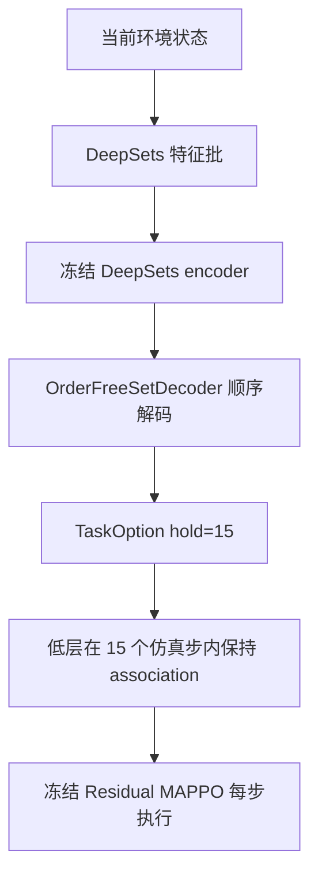
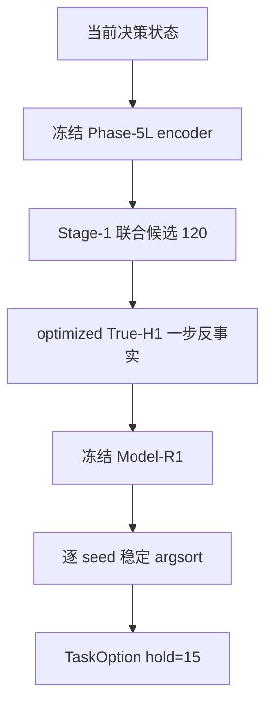

# Phase-5ZL 调用流程

正式决策函数没有被调用。下面两张图按磁盘上的正式代码和影子 adapter 画出。

## A. 当前正式高低层流程

| 步骤 | 输入 | 输出 | 形状 | 状态来源 | 频率 | 读环境 | 改真实环境 | 调用 MAPPO | 随机数 |
| --- | --- | --- | --- | --- | --- | --- | --- | --- | --- |
| DeepSets 特征 | info、位置、上一到达 | uav/buoy/edge | 正式 batch 带 batch 维 1 | 当前环境 | 每 15 个仿真步 | 是 | 否 | 否 | 否 |
| encoder | 特征批 | 节点表示 | 由冻结模型内部确定 | 特征批 | 同上 | 否 | 否 | 否 | 否 |
| 顺序解码 | 节点表示、未完成分配 | 六架 UAV 的目标 | (6,) int64，空闲为负 | 特征批和环境几何 | 同上 | 读取几何 | 否 | 否 | 正式路径不传入 shuffle seed |
| TaskOption | 分配 | targets、association、hold | targets (6,) | 解码结果 | 同上 | 否 | 否 | 否 | 否 |
| 低层执行 | TaskOption | 单位步动作 | (6, 2) | option 在 hold 期间保持 | 每个仿真步 1 s | 是 | 正式闭环中会改 | 是 | act 使用 mu，不采样 |

H1 不是这个正式流程的一步。正式低层在 hold 期间连续执行，不把单步响应交给高层重新打分。

## B. 拟议 True-H1 影子流程

| 步骤 | 输入 | 输出 | 形状 | 状态来源 | 频率 | 读环境 | 改真实环境 | 调用 MAPPO | 随机数 |
| --- | --- | --- | --- | --- | --- | --- | --- | --- | --- |
| encoder | 图特征 | logits | [6, 12] | 已消费快照 | 决策时刻 | 读快照 | 否 | 否 | 否 |
| 候选 | logits | 联合分配 | [120, 6] | encoder | 决策时刻 | 否 | 否 | 否 | 否 |
| True-H1 | 120 个联合分配 | 一步响应 | [120, 6, 14] | 同一决策状态的副本 | 每个候选一步，不是 15 步 | 读调用者，step 在副本 | 否 | 是，冻结 act | 否 |
| Model-R1 | 响应和关系特征 | value | [120] | 该候选的 response | 每个 seed 一次 | 否 | 否 | 否 | 否 |
| 选择 | value | 一个联合分配 | (6,) | 该 seed 的分数 | 决策时刻 | 否 | 否 | 否 | 否 |
| TaskOption | 选中分配 | hold=15 的 option | targets (6,) | 选中分配 | 决策时刻 | 否 | 否 | 否 | 否 |

副本上的一步响应用于打分。选出 option 之后，正式系统原有的 15 步 hold 语义不变。影子输出不驱动正式环境。
